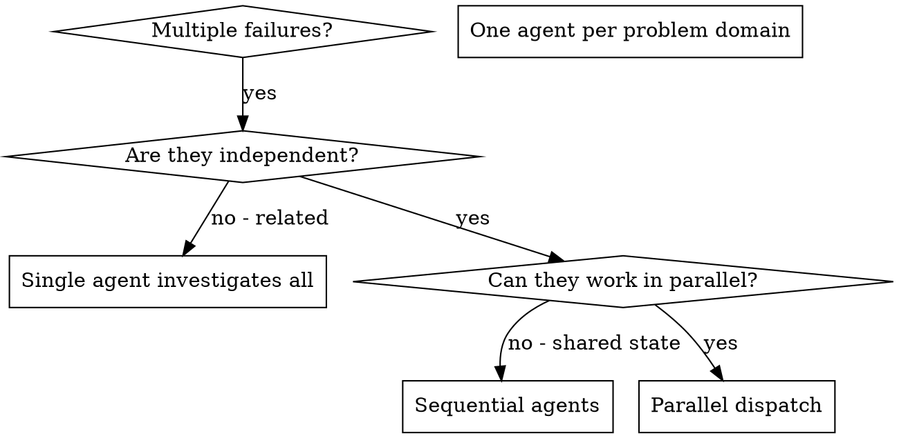

# 병렬 에이전트 디스패치하기 (Dispatching Parallel Agents)

## 개요 (Overview)

격리된 컨텍스트(isolated context)를 가진 전문 에이전트들에게 태스크를 위임합니다. 지침과 컨텍스트를 정교하게 구성해 전달함으로써, 에이전트들이 초점을 잃지 않고 태스크를 성공적으로 완수하도록 보장할 수 있습니다. 서브에이전트는 절대 당신 세션의 컨텍스트나 히스토리를 그대로 물려받아서는 안 됩니다 — 에이전트에게 필요한 것만 정확히 구성해서 전달하세요. 이렇게 하면 조율(coordination) 작업을 위한 당신 자신의 컨텍스트도 보존할 수 있습니다.

서로 관련 없는 여러 실패(서로 다른 테스트 파일, 서로 다른 서브시스템, 서로 다른 버그)가 발생했을 때 이를 순차적으로 조사하는 것은 시간 낭비입니다. 각 조사는 독립적이므로 병렬로 동시에 진행할 수 있습니다.

**핵심 원칙 (Core principle):** 독립적인 문제 도메인(problem domain)마다 하나의 에이전트를 디스패치하세요. 에이전트들이 동시에(concurrently) 작업하게 하세요.

## 언제 사용하는가 (When to Use)



**다음 경우에 사용하세요 (Use when):**
- 3개 이상의 테스트 파일이 서로 다른 근본 원인(root causes)으로 실패할 때
- 여러 서브시스템이 독립적으로 망가졌을 때
- 다른 문제의 컨텍스트 없이도 각 문제를 이해할 수 있을 때
- 조사 작업 간에 공유 상태(shared state)가 없을 때

**다음 경우에는 사용하지 마세요 (Don't use when):**
- 실패들이 서로 연관되어 있을 때 (하나를 고치면 다른 것들도 고쳐질 수 있는 경우)
- 전체 시스템 상태를 이해해야 할 때
- 에이전트들이 서로 간섭할 수 있을 때

## 패턴 (The Pattern)

### 1. 독립적인 도메인 식별 (Identify Independent Domains)

무엇이 망가졌는지를 기준으로 실패를 그룹화합니다:
- 파일 A 테스트: 도구 승인 흐름 (Tool approval flow)
- 파일 B 테스트: 배치 완료 동작 (Batch completion behavior)
- 파일 C 테스트: 중단 기능 (Abort functionality)

각 도메인은 독립적입니다 — 도구 승인 문제를 수정하는 것은 중단(abort) 테스트에 영향을 주지 않습니다.

### 2. 집중된 에이전트 태스크 생성 (Create Focused Agent Tasks)

각 에이전트에게 다음을 제공합니다:
- **구체적인 범위 (Specific scope):** 하나의 테스트 파일 또는 서브시스템
- **명확한 목표 (Clear goal):** 해당 테스트들을 통과시킬 것
- **제약 조건 (Constraints):** 다른 코드는 변경하지 말 것
- **기대 출력 (Expected output):** 발견한 사항과 수정한 내용에 대한 요약

### 3. 병렬로 디스패치 (Dispatch in Parallel)

동일한 응답(response)에서 세 개의 서브에이전트 디스패치를 모두 호출하세요 — 그러면 병렬로 실행됩니다:

```text
Subagent (general-purpose): "Fix agent-tool-abort.test.ts failures"
Subagent (general-purpose): "Fix batch-completion-behavior.test.ts failures"
Subagent (general-purpose): "Fix tool-approval-race-conditions.test.ts failures"
# 세 에이전트 모두 동시에(concurrently) 실행됩니다.
```

하나의 응답에서 여러 디스패치를 호출하면 = 병렬 실행(parallel execution)입니다. 응답마다 하나씩 호출하면 = 순차 실행(sequential)입니다.

### 4. 리뷰 및 통합 (Review and Integrate)

에이전트들이 작업을 마치고 돌아오면:
- 각 요약 보고를 읽습니다
- 수정 사항들이 서로 충돌하지 않는지 검증합니다
- 전체 테스트 스위트를 실행합니다
- 모든 변경 사항을 통합합니다

## 에이전트 프롬프트 구조 (Agent Prompt Structure)

좋은 에이전트 프롬프트는 다음과 같습니다:
1. **집중됨 (Focused)** - 하나의 명확한 문제 도메인만 다룸
2. **자체 완결적임 (Self-contained)** - 문제를 이해하는 데 필요한 모든 컨텍스트를 포함함
3. **출력 형식이 구체적임 (Specific about output)** - 에이전트가 무엇을 반환해야 하는지 명시함

```markdown
Fix the 3 failing tests in src/agents/agent-tool-abort.test.ts:

1. "should abort tool with partial output capture" - expects 'interrupted at' in message
2. "should handle mixed completed and aborted tools" - fast tool aborted instead of completed
3. "should properly track pendingToolCount" - expects 3 results but gets 0

These are timing/race condition issues. Your task:

1. Read the test file and understand what each test verifies
2. Identify root cause - timing issues or actual bugs?
3. Fix by:
   - Replacing arbitrary timeouts with event-based waiting
   - Fixing bugs in abort implementation if found
   - Adjusting test expectations if testing changed behavior

Do NOT just increase timeouts - find the real issue.

Return: Summary of what you found and what you fixed.
```

(프롬프트 내용 번역 참고:
`src/agents/agent-tool-abort.test.ts`에서 실패하는 3개의 테스트를 수정하세요:
1. "should abort tool with partial output capture" - 메시지에 'interrupted at'을 기대함
2. "should handle mixed completed and aborted tools" - 빠른 도구가 완료되지 않고 중단됨
3. "should properly track pendingToolCount" - 3개의 결과를 기대했으나 0개를 받음

이것들은 타이밍/경쟁 상태(race condition) 이슈입니다. 수행할 작업:
1. 테스트 파일을 읽고 각 테스트가 무엇을 검증하는지 이해하세요.
2. 근본 원인을 파악하세요 - 타이밍 이슈인가요, 아니면 실제 버그인가요?
3. 다음 방법으로 수정하세요:
   - 임의의 타임아웃을 이벤트 기반 대기로 교체
   - 중단(abort) 구현에 버그가 있다면 수정
   - 변경된 동작을 테스트하는 경우 테스트 기대치 조정
단순히 타임아웃 시간만 늘리지 마세요 - 진짜 원인을 찾으세요.
반환할 내용: 발견한 사항과 수정한 내용의 요약.)

## 흔한 실수 (Common Mistakes)

**❌ 너무 광범위함 (Too broad):** "모든 테스트를 고쳐라" - 에이전트가 길을 잃습니다
**✅ 구체적임 (Specific):** "`agent-tool-abort.test.ts`를 고쳐라" - 범위가 명확히 집중됨

**❌ 컨텍스트 없음 (No context):** "경쟁 상태(race condition)를 고쳐라" - 에이전트가 어디를 봐야 할지 모릅니다
**✅ 컨텍스트 제공 (Context):** 에러 메시지와 테스트 이름을 붙여넣어 줍니다

**❌ 제약 조건 없음 (No constraints):** 에이전트가 모든 코드를 리팩토링해 버릴 수 있습니다
**✅ 제약 조건 명시 (Constraints):** "프로덕션 코드는 변경하지 마세요" 또는 "테스트만 수정하세요"

**❌ 모호한 출력 요구 (Vague output):** "고쳐라" - 무엇이 변경되었는지 알 수 없습니다
**✅ 구체적인 출력 요구 (Specific):** "근본 원인과 변경 사항에 대한 요약을 반환하세요"

## 사용하지 말아야 할 때 (When NOT to Use)

**연관된 실패 (Related failures):** 하나를 고치면 다른 것들도 고쳐질 수 있는 경우 - 먼저 함께 조사하세요
**전체 컨텍스트 필요 (Need full context):** 문제를 이해하려면 전체 시스템을 봐야 하는 경우
**탐색적 디버깅 (Exploratory debugging):** 아직 무엇이 망가졌는지조차 모르는 경우
**공유 상태 (Shared state):** 에이전트들이 서로 간섭할 수 있는 경우 (동일한 파일 편집, 동일한 리소스 사용)

## 실제 세션 사례 (Real Example from Session)

**시나리오 (Scenario):** 대규모 리팩토링 이후 3개 파일에 걸쳐 6개의 테스트 실패 발생

**실패 내역 (Failures):**
- `agent-tool-abort.test.ts`: 3개 실패 (타이밍 이슈)
- `batch-completion-behavior.test.ts`: 2개 실패 (도구가 실행되지 않음)
- `tool-approval-race-conditions.test.ts`: 1개 실패 (실행 횟수 = 0)

**결정 (Decision):** 독립적인 도메인임 - 중단(abort) 로직은 배치 완료(batch completion)와 별개이고, 경쟁 상태(race conditions)와도 별개임

**디스패치 (Dispatch):**
```
Agent 1 → Fix agent-tool-abort.test.ts
Agent 2 → Fix batch-completion-behavior.test.ts
Agent 3 → Fix tool-approval-race-conditions.test.ts
```

**결과 (Results):**
- Agent 1: 타임아웃을 이벤트 기반 대기로 교체함
- Agent 2: 이벤트 구조 버그 수정 (`threadId`가 잘못된 위치에 있었음)
- Agent 3: 비동기 도구 실행이 완료될 때까지 대기 로직 추가

**통합 (Integration):** 모든 수정 사항이 독립적이었으며, 충돌 없이 전체 스위트가 통과(green)함

## 검증 (Verification)

에이전트들이 작업을 마치고 돌아온 후:
1. **각 요약 리뷰 (Review each summary)** - 무엇이 변경되었는지 이해합니다
2. **충돌 확인 (Check for conflicts)** - 에이전트들이 동일한 코드를 편집했는지 확인합니다
3. **전체 스위트 실행 (Run full suite)** - 모든 수정 사항이 함께 잘 작동하는지 검증합니다
4. **표본 점검 (Spot check)** - 에이전트들이 체계적인(systematic) 실수를 저질렀을 수 있으므로 확인합니다
