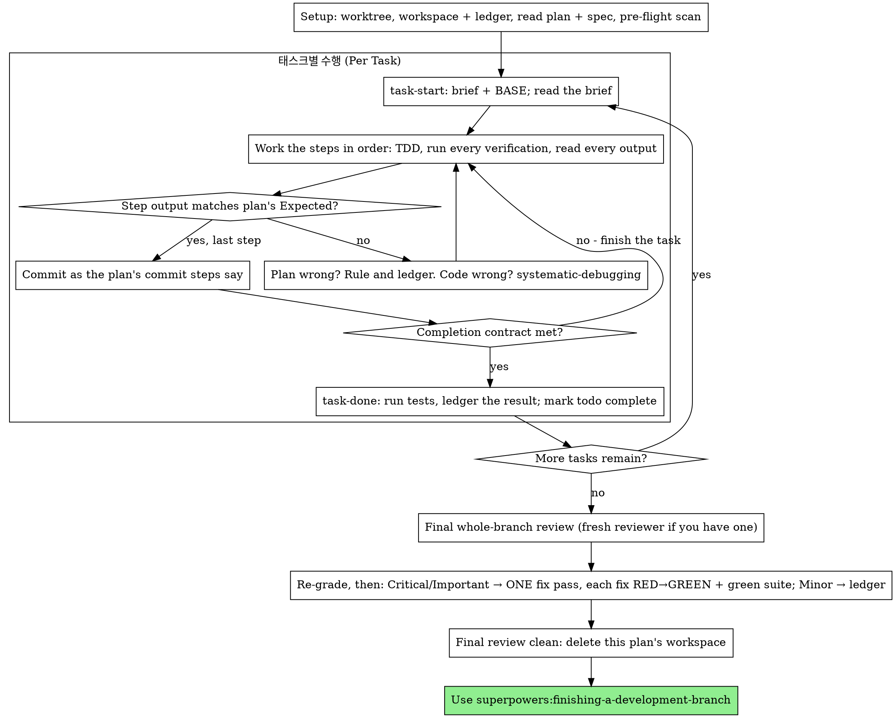

# 계획 실행하기 (Executing Plans)

이 세션에서 직접 태스크(task) 단위로 계획을 실행합니다. 태스크마다 구현자 서브에이전트(implementer subagent)를 두지 않고, 태스크마다 리뷰어(reviewer)를 두지도 않습니다. 마지막에 전체 브랜치에 대해 새로운 컨텍스트(fresh-context)에서 단 한 번의 리뷰만 수행합니다.

**인라인 실행을 하는 이유 (Why inline):** 서브에이전트 주도 개발(subagent-driven development)은 모든 태스크마다 새로운 구현자와 새로운 리뷰어 비용을 지불하며, 각 에이전트가 매번 코드베이스를 처음부터 다시 읽습니다. 인라인 실행(inline execution)은 하나의 컨텍스트(당신의 컨텍스트)에 더해 마지막의 리뷰어 하나에 대한 비용만 지불합니다. 포기하는 것은 태스크당 새로운 컨텍스트와 태스크당 두 번째 시선(second pair of eyes)입니다. 이 스킬은 그 두 가지가 제공하던 이점을 다른 수단으로 유지합니다. 즉, 브리프(brief)가 명세(spec) 역할을 하고, 원장(ledger)이 당신의 기억 역할을 하며, TDD가 태스크별 관문(gate)이 되고, 최종 리뷰어가 두 번째 시선이 됩니다.

**핵심 원칙 (Core principle):** 사고(thinking)는 이미 계획 단계에서 끝났습니다. 계획을 정확히 실행하고, 실패하는 것을 직접 확인한 뒤 통과시킨 테스트로 각 단계를 증명하며, 당신 자신이 잊어버리더라도 살아남는 기록을 남기세요.

**내레이션 (Narration):** 도구 호출(tool calls) 사이에는 최대 한 줄의 짧은 설명만 남기세요 — 기록은 원장(ledger)과 도구 실행 결과가 담당합니다.

**연속 실행 (Continuous execution):** 태스크 사이에 인간 파트너(human partner)에게 확인받기 위해 멈추지 마세요. 인간 파트너는 비용을 아끼려고 인라인 실행을 선택한 것이지, 매 태스크마다 "계속할까요?"에 답하려고 선택한 것이 아닙니다. 멈추지 말고 계획의 모든 태스크를 실행하세요.

**멈추지 말고 판정(Ruling)을 내리세요 (Rulings, not stalls).** 충돌, 모호함, 계획의 결함이 있다면 직접 결정하세요. 명세(spec)가 구속력 있는 최종 기준(binding authority)이고, 계획(plan)은 그 논거이며, 둘 다 답해주지 않는 것은 당신의 판단으로 매듭짓습니다. 모든 결정을 원장에 `Ruling: <결정 내용> — <이유> — <틀렸을 때의 비용>` 형식으로 기록하고 계속 진행하세요. 원장에 기록된 판정(ruling) 없이 계획에서 벗어나는 것은 몰래 내린 결정입니다.

당신을 멈춰 세우는 것은 오직 다음 네 가지뿐입니다: 되돌릴 수 없거나 파괴적인 작업, 보안에 민감한 작업, 관례상 먼저 물어봐야 하는 이 워크트리 외부로의 부작용(병합, 공유 브랜치로의 푸시, 배포/퍼블리시), 그리고 앞으로 나아가는 모든 경로가 추측일 정도로 심각하게 망가진 계획입니다. 이 네 가지 경우에만 멈추고 질문하세요.

## 언제 사용하는가 (When to Use)

- `superpowers:writing-plans`로 작성된 계획이 있고, 인간 파트너가 핸드오프(handoff) 시점에 인라인 실행을 선택한 경우.
- 하네스(harness)에 서브에이전트 도구가 없는 경우 (`../using-superpowers/references/`의 플랫폼별 참조 문서를 확인하세요). 절대 가짜 디스패치(dispatch)를 꾸며내지 말고, 여기서 계획을 직접 실행하세요.
- 태스크들이 대체로 독립적인 경우 — `superpowers:subagent-driven-development`와 동일한 전제 조건입니다.

완전히 구체화된 계획이 있다면 인라인 실행은 곧 내용을 옮겨 적고 테스트하는 작업(transcription plus testing)이 됩니다. 이는 중간 등급(mid-tier) 세션 모델에서도 잘 작동하며, 가장 뛰어난 모델이 그 비용 값을 해내는 유일한 지점은 이 스킬이 별도로 디스패치하는 최종 리뷰(final review)입니다. 인간 파트너가 인라인 실행을 선택할 때 이 점을 알려주세요.

인간 파트너가 모든 태스크마다 리뷰 게이트(review gate)를 원하거나, 계획이 너무 길어서 후반부 태스크들이 압축된 컨텍스트(compacted context)에서 실행될 것 같다면 `superpowers:subagent-driven-development`를 우선 고려하세요. 긴 계획에 대해 인라인 실행을 해도 작동은 하지만 — 원장(ledger) 덕분에 복구가 가능하기 때문입니다 — 마지막 태스크들은 당신의 역량을 가장 적게 할당받게 됩니다.

## 프로세스 (The Process)

## 초기 설정 (Setup)

작업이 격리된 작업 공간에서 이루어지도록 하세요. `superpowers:using-git-worktrees`를 사용해 작업 공간을 새로 만들거나 기존 작업 공간을 검증합니다. 인간 파트너의 명시적인 동의 없이 `main`/`master` 브랜치에서 바로 구현을 시작하지 마세요.

대화 기억(conversation memory)은 컨텍스트 압축(compaction) 이후에 살아남지 못합니다. 어디까지 진행했는지 잊어버린 인라인 실행자(inline executor)는 이미 커밋이 존재하는 태스크를 다시 구현하게 되는데, 이는 컨트롤러가 태스크를 재디스패치하는 것과 똑같은 실패를 당신 자신의 컨텍스트 비용으로 치르는 셈입니다. 진행 상황은 todo에만 기록하지 말고 원장(ledger) 파일에 추적하세요. 하네스의 todo는 실시간 뷰(live view)일 뿐이고, 원장이 진짜 기록입니다.

작업 공간과 원장은 `superpowers:subagent-driven-development`와 공유됩니다(동일한 디렉토리, 동일한 형식). 따라서 계획 실행 도중에 실행 방식을 바꾸더라도 새로운 실행자가 동일한 원장에서 이어받아 재개할 수 있습니다.

- 각 계획은 고유한 작업 공간을 가집니다. 스킬 시작 시 현재 실행 중인 작업 트리(working tree)에서 절대 경로로 `../subagent-driven-development/scripts/sdd-workspace PLAN_FILE`을 실행하세요. 그러면 해당 계획 전용의 git-ignore 처리된 디렉토리(`<repo-root>/.superpowers/sdd/<plan-basename>/`)가 출력되며, 이곳이 바로 **이 계획**의 모든 아티팩트(원장, 브리프, 리뷰 패키지)가 저장되는 홈 디렉토리입니다. 다른 계획의 디렉토리는 절대 읽거나 쓰지 마세요.
- `<workspace>/progress.md`에서 이 계획의 원장을 확인하세요. 첫 번째 줄에 현재 계획 파일 이름이 적혀 있다면, `Task <N>: complete` 줄이 있는 태스크는 이미 **완료(DONE)**된 것입니다. 다시 수행하지 말고, 해당 완료 표시가 없는 첫 번째 태스크부터 재개하세요. 당신의 컨텍스트가 커밋한 사실을 기억하지 못하더라도 커밋은 git에 남아 있습니다. 컨텍스트 압축 이후에는 자신의 기억보다 원장과 `git log`를 신뢰하세요. 첫 번째 줄에 다른 계획 파일 이름이 적힌 원장은 다른 계획의 진행 기록이므로 그대로 두고, 현재 계획의 원장을 새로 시작하세요.
- 원장을 생성할 때는 첫 번째 줄에 다음과 같이 식별 정보를 적습니다:
  `# SDD ledger — plan: <plan file path>`
- `git clean -fdx`를 실행하면 작업 공간이 삭제됩니다(git-ignore 처리된 임시 공간이기 때문입니다). 만약 삭제되었다면 `git log`를 통해 복구하세요.

계획을 한 번 읽고, 컨텍스트와 전역 제약 조건(Global Constraints)을 파악한 뒤, 태스크마다 todo를 생성하세요. 계획에 명세(Spec)가 언급되어 있다면 그것도 읽으세요. 명세는 계획의 근거가 되는 권위 있는 기준이며, 계획 내부의 충돌은 명세를 기준으로 해결합니다. 접근 가능한 명세가 없는 계획이라면 원장에 그렇다고 기록해 두세요 — 명세 없이 내린 판정(ruling)은 잠정적인(provisional) 것으로 간주됩니다.

**필수 하위 스킬 (REQUIRED SUB-SKILL):** Task 1을 시작하기 전에 지금 바로 `superpowers:test-driven-development`를 로드하세요. 이 스킬은 아래 모든 태스크의 모든 단계를 지배합니다. 계획의 단계에 이미 "실패하는 테스트를 먼저 작성하라"고 적혀 있다고 해서 이 스킬을 읽지 않아도 되는 것은 아닙니다.

Task 1을 시작하기 전에, 태스크 간의 충돌이 없는지 계획을 스캔하세요. 계획의 `Interfaces` 블록이 어디를 봐야 할지 알려줍니다. 이전 태스크가 생성한 것을 소비하는 모든 태스크에 대해 원장에 한 줄씩 기록하세요 — 두 태스크의 번호, 한쪽이 생성하는 것과 다른 쪽이 소비하는 것의 비교, 그리고 발견한 사항을 적습니다. 공유하는 인터페이스가 없는 태스크들은 행을 추가하지 않으며, 모든 태스크가 아무것도 공유하지 않는 계획은 `Pre-flight: no shared interfaces`라는 한 줄만 기록합니다. 각 행에서 드러난 충돌에 대해 명세를 최종 기준으로 삼아 판정(rule)을 내리고, 그 판정을 해당 행 옆에 기록한 뒤 Task 1을 시작하세요. 각 태스크 자체의 세부 텍스트는 여기서가 아니라 해당 태스크의 브리프를 읽을 때 확인합니다.

## 태스크 루프 (The Task Loop)

당신이 출력하는 모든 내용과 모든 도구 실행 결과는 세션이 끝날 때까지 컨텍스트에 상주합니다. 긴 테스트 출력은 작업 공간 내의 파일로 리다이렉트한 뒤 끝부분(tail)만 읽으세요. 계획 전체를 다시 읽지 말고 브리프(brief)만 읽으세요.

### 1. 태스크 가져오기 (Take the task)

- 현재 실행 중인 작업 트리에서 절대 경로로 이 스킬의 `scripts/task-start PLAN_FILE N`을 실행하세요. 한 번의 호출로 브리프 경로와 `BASE`(해당 태스크의 범위가 시작되는 기준 커밋)가 출력됩니다. 초기 설정(setup) 때 읽어서 기억하고 있는 태스크라 할지라도 모든 태스크마다 반드시 브리프를 읽으세요. 당신이 기억하는 것은 요약본일 뿐이며, 브리프에 정확한 값, 시그니처, 테스트 케이스가 들어 있습니다.
- 해당 태스크의 todo를 `in_progress`로 표시합니다.

모든 도구 호출은 전체 컨텍스트를 다시 읽는 하나의 턴(turn)을 소비합니다. 기록 작업(bookkeeping)은 실제 작업과 함께 묶어서 처리하세요 — 원장 추가(ledger append)는 별도의 도구 호출로 하지 말고 커밋과 동일한 호출 안에서 함께 수행하세요.

### 2. 단계별 작업 수행 (Work the steps)

계획의 단계들은 이미 RED-GREEN 순서로 되어 있습니다. 초기 설정 때 로드한 `superpowers:test-driven-development`에 따라 그 순서대로 진행하세요. 테스트 단계의 코드를 먼저 작성하고 먼저 실행합니다. 테스트가 실패하는 것을 직접 지켜보는 것은 단순한 요식 행위가 아니라 엄연한 하나의 단계입니다 — 구현이 존재하기 전에 통과하는 테스트는 테스트 자체에 문제가 있다는 발견(finding)입니다.

명령어를 실행하는 모든 단계에는 `Expected:` 줄이 있습니다. 명령어를 실행하고, 출력을 읽고, 비교하세요. 결과는 세 가지 중 하나입니다:

- **일치함 (Matches).** 다음 단계로 넘어갑니다.
- **코드가 잘못됨 (The code is wrong).** `superpowers:systematic-debugging`을 사용하세요. 원인을 찾아내야 하며, 단순히 단계의 출력만 맞추기 위해 증상을 임시방편으로 패치하지 마세요.
- **계획이 잘못됨 (The plan is wrong)** — 단계가 명세와 모순되거나, 이전 태스크의 인터페이스가 현재 태스크가 소비하는 것과 맞지 않거나, 작동할 수 없는 명령어인 경우입니다. 명세를 만족하는 가장 작은 변경으로 판정(rule)을 내리고, 원장에 `Task <N>: Ruling: <발견 사항> — <결정 내용 및 이유>`로 기록한 뒤 계속 진행하세요. 판정은 기억에 의존하는 것이 아니라 기록으로 전달됩니다. 동일한 인터페이스를 건드리는 이후 태스크들은 원장에서 이 판정을 읽게 됩니다.

계획의 커밋 단계에서 지시하는 대로 커밋하세요. 하나의 태스크가 여러 커밋에 걸쳐 있어도 괜찮습니다. 리뷰 범위의 기준점은 `HEAD~1`이 아니라 항상 `BASE`입니다.

### 3. 완료 계약 (The completion contract)

태스크의 원장 완료 줄을 기록하기 전에, 다음 모든 사항이 이 세션 내의 증거를 통해 참(true)이어야 합니다 — 단순히 diff가 괜찮아 보인다고 추론해서는 안 됩니다:

- 브리프에 명시된 모든 테스트가 존재하고 이번 태스크에서 실행되었으며, 당신이 그 출력을 직접 읽었습니다.
- 해당 태스크의 마지막 테스트 실행이 통과했습니다 — `task-done`이 바로 그 실행이며, 실행한 명령어와 결과를 원장 줄에 기록합니다.
- 브리프의 모든 `Expected:` 줄을 실제 출력과 비교했습니다.
- 브리프에서 벗어난 모든 변경 사항에 대해 원장에 `Ruling:` 줄이 기록되어 있습니다.

**필수 하위 스킬 (REQUIRED SUB-SKILL):** 완료 주장은 `superpowers:verification-before-completion`의 통제를 받습니다. 위 항목 중 하나라도 누락되었다면 태스크는 완료된 것이 아닙니다. 끝까지 마무리하세요.

### 4. 태스크 완료 (Complete the task)

현재 실행 중인 작업 트리에서 브리프가 해당 태스크 전체에 대해 지정한 테스트 명령어를 사용하여 이 스킬의 `scripts/task-done PLAN_FILE N BASE -- <test command>`를 절대 경로로 실행하세요. 이 스크립트는 테스트를 실행하고, 전체 출력을 작업 공간에 보관하며, 끝부분(tail)을 출력하고, **테스트가 통과한 경우에만** 원장에 다음 완료 줄을 추가합니다:

`Task <N>: complete (commits <base7>..<head7>, tests: <command> → <result>)`

실행이 실패하면 아무것도 기록되지 않으며, 태스크는 완료되지 않은 상태입니다. 원장에 기록되면 todo를 완료(`complete`)로 표시하고 다음 태스크를 가져오세요.

## 최종 리뷰 (Final Review)

현재 실행 중인 작업 트리에서 절대 경로로 `../subagent-driven-development/scripts/review-package PLAN_FILE MERGE_BASE HEAD`를 실행하고(`MERGE_BASE` = 브랜치가 분기된 시작 커밋, 예: `git merge-base main HEAD`), 출력된 파일을 기반으로 리뷰를 수행합니다.

**서브에이전트 도구가 있는 경우 (With a subagent tool):** 전체 브랜치 리뷰는 고도의 판단이 필요한 작업이므로, 사용 가능한 가장 뛰어난(most capable) 모델로 리뷰어를 디스패치하세요. 이때 `superpowers:requesting-code-review`의 [code-reviewer.md](../requesting-code-review/code-reviewer.md)를 사용하며, 패키지 경로, 계획 및 명세 경로, 계획에 Review Focus 섹션이 있다면 그 원문 그대로(계획의 테스트가 다루지 않는 입력 클래스와 실패 모드들 — 리뷰어가 각각을 의도적으로 점검함), 그리고 당신이 내린 결정을 리뷰어가 가늠해 볼 수 있도록 원장의 `Ruling:` 줄들에 대한 포인터를 함께 전달합니다. 모델을 명시적으로 지정하세요. 모델을 생략하면 현재 세션의 모델을 상속받게 되는데, 이는 가장 뛰어난 모델이 아닐 수 있습니다. 이것이 전체 실행을 통틀어 구매하는 유일한 새로운 컨텍스트(fresh context)입니다. 절대 건너뛰지 마시고, 자신이 직접 diff를 읽는 것으로 대체하지 마세요.

**서브에이전트 도구가 없는 경우 (Without a subagent tool):** 마지막 태스크의 원장 줄이 기록된 이후 별도의 패스(pass)로서, `code-reviewer.md`를 읽고 패키지에 대해 직접 해당 리뷰를 수행하세요. 원장에 `Final review: self-review (no subagent tool)`라고 기록하고, 최종 메시지에서도 그 사실을 밝히세요. 작성자 본인의 셀프 리뷰는 새로운 리뷰어의 리뷰보다 취약하므로, 병합 전에 그것으로 충분한지는 인간 파트너가 결정합니다.

발견 사항(findings)에 대해 조치를 취하기 전에 먼저 분류(sort)부터 하세요. 리뷰어가 매긴 심각도(severity) 라벨은 조언일 뿐이며, 게이트(gate)의 결정권은 당신에게 있습니다. 리뷰어의 "판정 보류(Declined to judge)" 목록 역시 당신의 몫입니다. 거기에 적힌 모든 줄은 계획 충돌과 똑같이 당신이 직접 판정을 내리고 원장에 기록해야 합니다 — `Final: Ruling: <리뷰어가 보류한 동작> — <이 소프트웨어를 사용하는 합리적인 사람이 겪게 되는 결과, 그리고 왜 현 상태가 유지되는지 또는 왜 이제 수정 대상(finding)이 되는지> — <틀렸을 때의 비용>`. 먼저 영향도(effect)를 기준으로 등급을 재산정(re-grade)하세요. 명세는 비전 문서이며, 발견 사항의 등급은 명세가 해당 트리거 입력을 언급했는지 여부가 아니라 그것이 그대로 배포되었을 때 이 소프트웨어를 사용하는 합리적인 사람이 무엇을 겪게 되는지에 따라 결정됩니다 — 명세에 언급이 없다는 이유로 리뷰어가 Minor로 분류했다면, 그것은 영향도가 아니라 명세를 평가한 것입니다. 재산정 후 다음과 같이 처리합니다:

- **Critical 및 Important**는 수정 패스(fix pass)로 들어갑니다.
- **Minor**는 원장에 `Final: minor (deferred): <한 줄 요약>`으로 기록하고, 최종 메시지의 "Deferred minors" 아래에 포함시킵니다. Minor는 절대 수정 패스에 들어가지 않으며, 절대 판정(ruling)이 되지도 않습니다 — 판정은 충돌에 대한 결정이지, 다듬기(polish) 제안을 거절했다는 메모가 아닙니다.

당신이 여기서 구현자이므로 Critical 및 Important 발견 사항을 **단 한 번의 패스(ONE pass)**로 직접 수정하세요. 각 수정은 두 번째 리뷰어가 아니라 TDD로 검증합니다. 즉, 발견 사항을 재현하는 테스트를 작성하고, 실패하는 것을 확인하고, 통과하게 만든 다음, 전체 테스트 스위트를 실행하세요. 각 수정을 원장에 `Final: fixed <finding> — <test name> RED→GREEN, suite <N>/<N>` 형식으로 기록합니다. 먼저 실패하는 테스트가 없는 수정은 검증된 것이 아니며, 패스 이후 전체 스위트가 초록불(green)이 아니라면 패스가 끝난 것이 아닙니다. 재리뷰(re-review)를 디스패치하지 마세요. 해당 테스트가 이미 "해결되었음"을 증명하고 전체 스위트 실행이 이미 "아무것도 망가뜨리지 않았음"을 증명하는 diff를 다시 읽는 것에 불과합니다.

수정하지 않기로 결정한 발견 사항은 판정(ruling)이 됩니다 — `Final: Ruling: <발견 사항> — <현재 코드를 유지하는 이유> — <틀렸을 때의 비용>`으로 기록하며, 판정 목록을 통해 인간 파트너에게 전달됩니다. 두 번째 수정 패스는 없습니다.

## 마무리 (Finish)

무언가를 삭제하기 전에, 원장에서 `Ruling:`이 포함된 모든 줄을 판정을 내린 순서대로 각각 틀렸을 때의 비용과 함께 수집하여 최종 메시지의 "Rulings I made" 아래에 정리하고, 모든 `minor (deferred)` 줄을 "Deferred minors" 아래에 정리하세요. 두 목록 모두 하나도 빠짐없이(exhaustive) 작성해야 합니다. 당신의 최종 메시지는 당신이 인간 파트너를 대신해 내린 결정들과 조치하지 않기로 선택한 발견 사항들이 인간 파트너에게 도달하는 유일한 통로입니다.

최종 리뷰가 깨끗하게 마무리되고 수정 사항들이 모두 커밋되면, 이 계획의 작업 공간 디렉토리를 삭제하세요 — 이제부터는 git 히스토리가 공식 기록입니다. 같은 레벨의 다른 디렉토리들은 다른 계획의 소유이므로 건드리지 마세요.

`superpowers:finishing-a-development-branch`를 사용하세요.

## 흔한 합리화 (Common Rationalizations)

| 변명 (Excuse) | 현실 (Reality) |
|--------|---------|
| "Task N이 무슨 내용인지 기억나" | 당신이 기억하는 것은 요약본입니다. 정확한 값은 브리프에 있습니다. 브리프를 읽으세요. |
| "계획에 적힌 코드가 맞으니 테스트 실패 확인은 건너뛰자" | 실패하는 것을 직접 보지 못한 테스트는 아무것도 증명하지 못합니다. 단 한 단계일 뿐입니다. 실행하세요. |
| "단계마다 실행하지 말고 마지막에 전체 스위트를 한 번에 돌릴래" | 단계별 실행을 해야 어느 단계에서 망가졌는지 알 수 있습니다. 태스크 마지막의 실행은 완료 계약이지, 단계별 실행의 대체재가 아닙니다. |
| "여긴 계획이 틀렸네, 그냥 올바른 방법대로 고쳐야지" | 올바른 방법대로 고치되, 반드시 판정(ruling)을 원장에 기록하세요. 원장에 기록하지 않은 이탈은 몰래 내린 결정입니다. |
| "원장 기록은 태스크 몇 개 끝내고 몰아서 적을래" | 컨텍스트 압축(compaction)은 당신이 편할 때까지 기다려주지 않습니다. 태스크당 한 줄씩, 커밋과 동일한 메시지에서 기록하세요. |
| "다음 태스크로 넘어가기 전에 중간 점검을 받아야지" | 인간 파트너는 비용을 줄이려고 인라인 실행을 선택했습니다. 진행 여부를 묻는 프롬프트는 대신 파트너의 시간을 소모합니다. 오직 네 가지 중단 조건만 당신을 멈출 수 있습니다. |
| "내 diff를 내가 꼼꼼히 읽었으니 최종 리뷰어는 중복이야" | 같은 작성자는 같은 맹점(blind spots)을 가집니다. 최종 리뷰어는 이번 실행에서 얻을 수 있는 유일한 새로운 컨텍스트입니다. |
| "사소한 변경이니 테스트는 당연히 통과할 거야" | "당연히(~일 것이다)"는 증거가 아닙니다. 완료 계약은 실제 명령어 실행과 그 출력을 요구합니다. |
| "서브에이전트는 느리고 비싸니 최종 리뷰도 건너뛰자" | 인라인 실행은 이미 태스크별 리뷰어를 제거했습니다. 전체 브랜치에 대한 단 한 번의 리뷰는 최대치가 아니라 최소한의 바닥선(floor)입니다. |
| "리뷰어가 Minor라고 했으니 Minor가 맞겠지" | 그 라벨은 명세의 침묵을 평가한 것입니다. 사용자가 겪게 될 결과를 평가하세요. 등급을 재산정(re-grade)한 뒤에 게이트를 적용하세요. |
| "수정이 너무 자명하니 실패하는 테스트를 먼저 만들 필요 없어" | 실패하는 테스트만이 그 발견 사항이 실제 문제였고 이제 사라졌음을 증명하는 유일한 증거입니다. 그것이 없다면 당신에게 있는 건 diff와 희망 사항뿐입니다. |
| "코드를 건드리는 김에 Minor 이슈들도 같이 고쳐야지" | 당신이 고치는 모든 Minor 이슈는 인간 파트너가 요청하지 않은 테스트, 수정, 스위트 실행 비용을 발생시킵니다. 원장에 기록만 하세요. 결정은 파트너가 합니다. |
