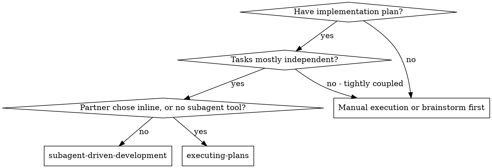
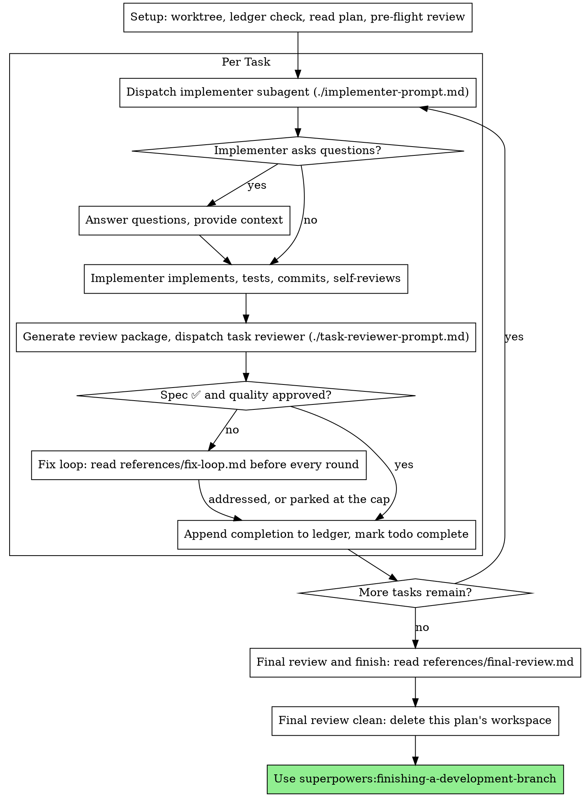

# 서브에이전트 기반 개발 (Subagent-Driven Development)

각 태스크마다 새로운 구현자(implementer) 서브에이전트를 디스패치하고, 각 태스크 완료 후 태스크 리뷰(명세 준수 여부 + 코드 품질)를 수행하며, 마지막에 브랜치 전체에 대한 광범위한 리뷰를 거쳐 계획을 실행합니다.

**왜 서브에이전트를 사용하는가:** 격리된 컨텍스트를 가진 전문화된 에이전트에게 태스크를 위임합니다. 지침과 컨텍스트를 정밀하게 구성하여 전달함으로써, 서브에이전트가 흔들리지 않고 집중하여 태스크를 성공적으로 완수하도록 보장합니다. 서브에이전트는 현재 세션의 컨텍스트나 히스토리를 절대 물려받아서는 안 되며, 오직 필요한 내용만 정확히 구성해서 전달해야 합니다. 이를 통해 컨트롤러 자신의 컨텍스트도 전체 조율(coordination) 작업을 위해 온전히 보존할 수 있습니다.

**핵심 원칙:** 태스크별 새로운 서브에이전트 + 태스크 리뷰(명세 + 품질) + 광범위한 최종 리뷰 = 높은 품질, 빠른 이터레이션

**내레이션(Narration):** 도구 호출 사이에는 최대 한 줄의 짧은 설명만 덧붙이세요 — 상세한 기록은 원장(ledger)과 도구 실행 결과에 남습니다.

**연속 실행(Continuous execution):** 태스크 사이에 인간 파트너(human partner)의 확인을 받으려고 멈추지 마세요. 계획에 있는 모든 태스크를 멈추지 말고 끝까지 실행하세요. 멈춰야 하는 유일한 이유는 아래에 명시된 네 가지 경우이거나, 모든 태스크가 완료되었을 때뿐입니다. "계속할까요?" 같은 질문이나 중간 진행 상황 요약은 인간 파트너의 시간을 낭비합니다 — 파트너는 계획을 실행하라고 요청했으므로, 그대로 실행하세요.

**멈추지 말고 판정(Rulings)을 내리세요.** 실행 중인 계획은 사람을 기다리지 않습니다. 충돌, 모호함, 계획의 결함, 평소라면 초과해도 될지 물어봤을 한도(cap) 등이 발생하면 직접 결정하세요. 명세(spec)가 구속력 있는 최종 기준이고, 계획(plan)은 그 명세를 구현하기 위한 논거이며, 둘 다 답해주지 않는 부분은 당신의 판단으로 결정합니다. 모든 결정은 원장(ledger)에 `Ruling: <결정 내용> — <이유> — <틀렸을 때의 비용>` 형식으로 기록하고 계속 진행하세요. 잘못된 판정은 인간 파트너가 확인하고 되돌릴 수 있는 재작업 비용만 들지만, 질문 하나 때문에 멈춰버린 세션은 파트너의 하루 전체를 날려버리고 아무것도 남기지 못합니다.

당신을 멈추게 하는 것은 오직 다음 네 가지뿐입니다: 되돌릴 수 없거나 파괴적인 작업, 보안에 민감한 작업, 관례상 먼저 물어봐야 하는 현재 워크트리(worktree) 외부로의 부작용(병합, 공유 브랜치로의 푸시, 배포/퍼블리시), 그리고 앞으로 나아가는 모든 경로가 단순한 추측일 정도로 심각하게 망가진 계획. 이 네 가지 경우에만 멈추고 질문하세요.

## 언제 사용하는가

**vs. 계획 실행하기 (`executing-plans`, 인라인 실행):**
- 하나의 컨텍스트에서 모든 태스크를 처리하는 대신, 태스크마다 새로운 서브에이전트를 사용함 (컨텍스트 오염 방지)
- 맨 마지막에 한 번만 리뷰하는 대신, 각 태스크가 끝날 때마다 리뷰를 수행함 (명세 준수 여부 + 코드 품질)
- 태스크마다, 그리고 리뷰마다 새로운 컨텍스트 비용이 발생함 (반면 인라인 방식은 하나의 컨텍스트와 하나의 최종 리뷰어만 사용)
- 두 방식 모두 현재 세션에서 실행되고, 동일한 계획 워크스페이스와 원장(ledger)을 공유하며, 태스크 사이에 절대 멈추지 않음

## 프로세스

## 초기 설정 (Setup)

격리된 워크스페이스에서 작업이 이루어지도록 보장하세요: `superpowers:using-git-worktrees`를 사용하여 새 워크트리를 생성하거나 기존 워크트리를 검증하세요. 인간 파트너(human partner)의 명시적인 동의 없이 `main`/`master` 브랜치에서 구현을 시작해서는 절대 안 됩니다.

대화 메모리는 컨텍스트 압축(compaction)을 거치면 사라집니다. 실제 세션에서, 어디까지 진행했는지 잊어버린 컨트롤러가 이미 완료된 전체 태스크 시퀀스를 처음부터 다시 디스패치한 사례가 있었으며, 이는 관찰된 실패 중 단일 비용으로 가장 큰 손실을 초래했습니다. 진행 상황은 todo 목록뿐만 아니라 반드시 원장(ledger) 파일에 기록하여 추적하세요.

- 각 계획은 고유한 워크스페이스를 가집니다: 스킬을 시작할 때, 현재 실행 중인 작업 트리(working tree)에서 이 스킬의 `bash scripts/sdd-workspace PLAN_FILE`을 절대 경로로 실행하세요. 이 명령은 해당 계획 전용의 git-ignored 디렉토리 경로(`<repo-root>/.superpowers/sdd/` 하위)를 출력하며, 이곳에 원장(ledger), 브리프(briefs), 보고서(reports), 리뷰 패키지(review packages) 등 **이 계획**에 속한 모든 아티팩트가 저장됩니다. 다른 계획의 디렉토리는 절대 읽거나 쓰지 마세요.
- `<workspace>/progress.md`에 이 계획의 원장이 이미 존재하는지 확인하세요. 만약 존재한다면, 다른 작업을 하기 전에 먼저 [references/resuming.md](references/resuming.md)를 읽으세요: 누구의 원장인지, 그리고 어디서부터 재개해야 하는지가 설명되어 있습니다.
- 첫 줄에 원장의 식별 정보를 넣어 원장을 생성하세요:
  `# SDD ledger — plan: <plan file path>`.
- 원장은 당신의 복구 지도입니다: 원장에 기록된 커밋들은 컨텍스트 압축으로 인해 당신의 기억에서 사라진 뒤에도 git에는 그대로 남아 있습니다. 컨텍스트 압축 이후에는 당신 자신의 기억보다 원장과 `git log`를 신뢰하세요.
- `git clean -fdx`를 실행하면 워크스페이스가 삭제됩니다(git-ignored 임시 공간이기 때문). 만약 그런 일이 발생하면 `git log`를 통해 복구하세요.

계획을 한 번 읽고, 전체 컨텍스트와 전역 제약 조건(Global Constraints)을 파악한 뒤, 각 태스크마다 todo 항목을 생성하세요. 계획에 명세(Spec)가 언급되어 있다면 그 명세도 함께 읽으세요: 명세는 계획이 근거로 삼는 최종 기준이며, 계획 내부의 모순이나 충돌은 명세를 기준으로 해결합니다. 접근 가능한 명세가 없는 계획의 경우 원장에 그 사실을 기록해 두세요 — 명세 없이 내려진 판정(ruling)은 잠정적인 것으로 간주됩니다.

Task 1을 디스패치하기 전에 [references/preflight.md](references/preflight.md)를 읽고 거기에 설명된 충돌 스캔(conflict scan)을 실행하세요. 스캔 결과 표와 판정 내용은 원장에 기록합니다.

## 모델 선택 (Model Selection)

비용을 절약하고 속도를 높이기 위해, 각 역할을 처리할 수 있는 가장 가벼운 모델을 사용하세요.

**기계적인 구현 태스크** (격리된 함수, 명확한 명세, 1~2개 파일 수정): 빠르고 저렴한 모델을 사용하세요. 계획이 잘 구체화되어 있다면 대부분의 구현 태스크는 기계적인 작업입니다.

**통합 및 판단이 필요한 태스크** (여러 파일 간의 조율, 패턴 매칭, 디버깅): 표준(standard) 모델을 사용하세요.

**아키텍처 및 설계 태스크**: 사용 가능한 가장 뛰어난(most capable) 모델을 사용하세요. 마지막에 수행하는 브랜치 전체 최종 리뷰가 여기에 해당합니다 — 세션 기본 모델이 아니라 사용 가능한 가장 뛰어난 모델로 디스패치하세요.

**리뷰 태스크**: diff의 크기, 복잡도, 위험도에 비례하여 동일한 판단 기준으로 모델을 선택하세요. 작고 기계적인 diff에는 최고 성능의 모델이 필요하지 않지만, 미묘한 동시성(concurrency) 변경에는 최고 성능의 모델이 필요합니다. 작은 수정 diff에 대한 범위 지정 재리뷰(scoped re-review)에는 저렴하거나 중간 등급(cheap-to-mid tier)의 모델을 사용합니다.

**수정 루프 에스컬레이션 (Fix-loop escalation, 4~5라운드)**: 막혀버린 기존 구현자보다 최소 한 단계 이상 높은 등급의 모델을 사용하세요.

**서브에이전트를 디스패치할 때는 항상 모델을 명시적으로 지정하세요.** 모델을 생략하면 현재 세션의 모델(보통 가장 뛰어나고 가장 비싼 모델)을 그대로 상속받게 되어, 이 섹션의 원칙이 소리 없이 무력화됩니다.

**토큰 단가보다 턴(turn) 수가 더 중요합니다.** 실제 소요 시간(wall-clock)과 컨텍스트 비용은 서브에이전트가 소모하는 턴 수에 비례하며, 가장 저렴한 모델들은 다단계 작업에서 보통 2~3배 더 많은 턴을 소모하여 결과적으로 전체 비용이 더 많이 듭니다. 리뷰어와 산문 형태의 설명을 바탕으로 작업하는 구현자에게는 중간 등급(mid-tier) 모델을 최소 기준(floor)으로 사용하세요. 태스크의 계획 텍스트에 작성해야 할 전체 코드가 이미 포함되어 있는 경우, 구현 작업은 단순 전사(transcription)와 테스트 실행뿐이므로 해당 구현자에게는 가장 저렴한 등급을 사용하세요. 단일 파일에 대한 기계적인 수정 작업 역시 가장 저렴한 등급을 사용합니다.

**태스크 복잡도 신호 (구현 태스크):**
- 완전한 명세가 주어지고 1~2개 파일만 건드림 → 저렴한 모델 (cheap model)
- 통합 이슈가 걸려 있고 여러 파일을 건드림 → 표준 모델 (standard model)
- 설계상의 판단이나 코드베이스 전반에 대한 폭넓은 이해가 필요함 → 가장 뛰어난 모델 (most capable model)

## 태스크 루프 (The Task Loop)

**동일한 형태의 작은 작업들:** 계획에 여러 파일에 걸쳐 동일한 종류의 작은 수정 작업이 여러 개 나열되어 있다면, 디스패치하기 전에 [references/batching.md](references/batching.md)를 읽으세요.

디스패치 프롬프트에 붙여넣는 모든 내용과 서브에이전트가 응답으로 출력하는 모든 내용은 세션이 끝날 때까지 당신의 컨텍스트에 상주하며 이후 매 턴마다 다시 읽히게 됩니다. 아티팩트는 파일 경로로 전달하세요.

**디스패치된 서브에이전트 대기하기:** 짧은 타임아웃으로 대기 인터페이스를 폴링(polling)하지 말고, 반대로 아무런 확인 없이 무기한 대기 상태로만 앉아 있지도 마세요. 원장 업데이트, 다음 리뷰 패키징, 보고서 읽기 등 로컬에서 할 작업이 있다면 계속 작업을 진행하세요. 자식 에이전트의 결과는 완료되면 알아서 도착합니다. 정말로 할 일이 없어 대기해야 할 때는 플랫폼이 허용하는 범위 내에서 일정한 시간 단위(5~10분)로 끊어서 대기하고, 대기 구간 사이마다 한 줄짜리 상태 메시지를 남기며 실행 중인 자식 에이전트들의 상태를 점검하세요: 자식 에이전트 목록을 확인하고, 보고 없이 종료된 에이전트가 있다면 추적하세요. 이렇게 일정 시간 단위로 끊어 대기하면 긴 대기의 효율성을 거의 그대로 유지하면서도, 멈추거나 길을 잃은 자식 에이전트를 세션이 끝날 때가 아니라 몇 분 내에 즉시 발견할 수 있습니다.

### 1. 구현자(Implementer) 디스패치하기

디스패치하기 전에 BASE 커밋(`git rev-parse HEAD`)을 기록해 두세요 — 리뷰 패키지 생성과 수정 라운드(fix-round)의 diff 추출에 필요합니다.

- **태스크 브리프(Task brief):** 구현자를 디스패치하기 전에, 현재 실행 중인 작업 트리에서 이 스킬의 `bash scripts/task-brief PLAN_FILE N`을 절대 경로로 실행하세요. 이 스크립트는 해당 태스크의 전체 텍스트를 고유한 이름의 파일로 추출하고 그 경로를 출력합니다. 이 브리프 파일이 요구사항의 단일 진실 공급원(single source of truth)이 되도록 디스패치 프롬프트를 작성하세요. 디스패치 프롬프트에는 다음 내용이 포함되어야 합니다: (1) 이 태스크가 프로젝트 전체에서 차지하는 위치에 대한 한 줄 설명, (2) "이 파일을 가장 먼저 읽으세요 — 그대로 사용해야 할 정확한 값들이 담긴 요구사항입니다"라고 안내하는 브리프 파일 경로, (3) 브리프에는 나와 있지 않지만 이전 태스크들에서 결정된 인터페이스 및 의사결정 사항, (4) 브리프에서 발견한 모호한 부분에 대한 당신의 해결 지침, (5) 보고서 파일 경로 및 보고서 작성 규약(contract). 정확한 값(숫자, 매직 스트링, 함수 시그니처, 테스트 케이스)은 오직 브리프 파일에만 있어야 합니다. 서브에이전트에게 전체 계획 파일을 읽게 하지 마세요.
- **보고서 파일(Report file):** 구현자의 보고서 파일 이름은 브리프 파일 이름을 따라 지정하고(예: 브리프가 `…/task-N-brief.md`이면 보고서는 `…/task-N-report.md`), 이를 디스패치 프롬프트에 명시하세요. 구현자는 전체 상세 보고서를 해당 파일에 작성하고, 응답으로는 오직 상태(status), 생성한 커밋, 한 줄짜리 테스트 요약, 그리고 우려 사항(concerns)만 반환합니다.
- 디스패치 프롬프트는 세션의 히스토리가 아니라 단일 태스크 하나만을 설명해야 합니다. 이후 태스크를 디스패치할 때 이전 태스크들의 누적 요약("Task 1~3 이후의 상태" 등)을 붙여넣지 마세요 — 실제 세션에서 디스패치 프롬프트가 42,000자에 달했는데 그중 99%가 붙여넣은 히스토리였던 사례가 있습니다. 새로운 서브에이전트에게는 자신이 맡은 태스크, 자신이 건드리는 인터페이스, 그리고 전역 제약 조건만 있으면 됩니다. 그 외에는 아무것도 필요 없습니다.
- 디스패치에는 서브에이전트 생성 금지 규약(no-subagents contract, 구현자 템플릿에 포함되어 있음)이 담겨 있습니다: 구현자는 보조 에이전트든 리뷰어든 절대 하위 서브에이전트를 디스패치하지 않습니다. 리뷰는 구현자가 보고서를 제출한 후 컨트롤러인 당신이 직접 디스패치합니다. 실제 세션에서 작업자(worker)가 자체적으로 생성한 모든 리뷰어는 어차피 컨트롤러가 디스패치할 태스크 리뷰와 완전히 중복되었으며, 태스크당 리뷰어 좌석 하나분의 비용을 통째로 낭비했습니다.
- 이전 태스크에서 현재 태스크가 건드리는 영역에 대해 보류(parked)해 둔 지적 사항이 있다면, 디스패치 프롬프트에 해당 원장 항목을 가리키는 포인터를 포함하세요.
- 디스패치 결과에서 구현자의 에이전트 식별자(agent identity)를 기록해 두세요 — 수정 루프(fix-loop) 1~3라운드에서는 이 에이전트를 재개(resume)하여 사용합니다.
- 여러 구현 서브에이전트를 병렬로 디스패치하지 마세요 (충돌이 발생합니다).

템플릿: [implementer-prompt.md](implementer-prompt.md)

### 2. 보고서 처리하기

구현자 서브에이전트는 네 가지 상태 중 하나를 보고합니다. 각 상태에 맞게 적절히 처리하세요:

**DONE:** 리뷰 패키지를 생성한 뒤(현재 실행 중인 작업 트리에서 `bash scripts/review-package PLAN_FILE BASE HEAD`를 절대 경로로 실행하면 생성된 고유 파일 경로가 출력됨. 여기서 BASE는 구현자를 디스패치하기 전에 기록해 둔 커밋이어야 하며, 절대 `HEAD~1`을 사용하지 마세요 — 여러 커밋으로 이루어진 태스크에서 마지막 커밋을 제외한 모든 커밋이 소리 없이 누락됩니다), 출력된 경로를 전달하여 태스크 리뷰어를 디스패치하세요.

**그 외의 모든 상태** (DONE_WITH_CONCERNS, NEEDS_CONTEXT, BLOCKED): 이러한 상태를 보고받을 때마다 [references/handling-reports.md](references/handling-reports.md)를 읽고 지침을 따르세요.

구현자가 작업 시작 전이나 작업 도중에 질문을 해오면, 명확하고 완전하게 답변하고 필요한 경우 추가 컨텍스트를 제공하세요. 성급하게 구현을 재촉하지 마세요.

### 3. 태스크 리뷰하기

태스크별 리뷰는 해당 태스크 범위로 한정된 관문(task-scoped gate)입니다. 광범위한 전체 리뷰는 맨 마지막의 브랜치 전체 최종 리뷰에서 단 한 번 수행됩니다. 태스크 리뷰를 절대 건너뛰지 마시고, 두 가지 평결(명세 준수 여부와 태스크 품질) 중 하나라도 누락된 보고서는 절대 승인하지 마세요 — 두 가지 모두 필수입니다. 구현자의 자체 리뷰(self-review)는 태스크 리뷰를 대체할 수 없으며, 둘 다 필요합니다.

- 리뷰어에게 diff를 파일로 전달하세요: 현재 실행 중인 작업 트리에서 이 스킬의 `bash scripts/review-package PLAN_FILE BASE HEAD`를 절대 경로로 실행하고, 출력된 파일 경로를 리뷰어에게 전달하세요 (만약 bash를 사용할 수 없다면 해당 범위에 대한 `git log --oneline`, `git diff --stat`, `git diff -U10` 출력을 고유한 이름의 단일 파일로 리다이렉션하세요). 이렇게 하면 diff 출력이 당신의 컨텍스트에 들어오지 않으며, 리뷰어는 단 한 번의 Read 호출로 커밋 목록, 통계 요약, 그리고 주변 컨텍스트가 포함된 전체 diff를 볼 수 있습니다. 반드시 구현자를 디스패치하기 전에 기록해 둔 BASE를 사용하세요 — 다중 커밋 태스크를 소리 없이 잘라버리는 `HEAD~1`은 절대 사용하지 마세요. diff 파일 없이 태스크 리뷰어를 디스패치하지 마세요.
- **리뷰어 입력값:** 태스크 리뷰어는 세 개의 파일 경로(동일한 브리프 파일, 보고서 파일, 리뷰 패키지 파일)와 해당 태스크에 적용되는 전역 제약 조건(global constraints)을 전달받습니다.
- 리뷰어에게 전달하는 전역 제약 조건 블록은 리뷰어가 집중해서 봐야 할 렌즈 역할을 합니다. 계획의 Global Constraints 섹션이나 명세에서 구속력 있는 요구사항들(정확한 값, 정확한 포맷, 그리고 "X와 동일한 레이아웃", "Y와 일치함" 등 컴포넌트 간의 명시된 관계)을 글자 그대로 복사해 넣으세요. 프로세스 규칙(YAGNI, 테스트 위생, 리뷰 방법론 등)은 리뷰어 템플릿에 이미 포함되어 있으므로, 제약 조건 블록에는 오직 **이 프로젝트의 명세가 요구하는 사항**만 담으면 됩니다.
- 구체적이고 태스크에 특화된 이유 없이 "모든 사용처를 확인하라"거나 "유용하다면 레이스(race) 테스트를 실행하라" 같은 막연하고 열린 지시를 추가하지 마세요.
- 구현자가 동일한 코드에 대해 이미 실행한 테스트를 리뷰어에게 다시 실행하라고 요구하지 마세요 — 구현자의 보고서에 이미 테스트 증거가 담겨 있습니다.
- 리뷰어를 대신해 지적 사항을 미리 예단(pre-judge)하지 마세요 — 특정 이슈를 무시하라거나 지적하지 말라고 리뷰어에게 지시해서는 절대 안 됩니다. 어떤 지적 사항이 오탐(false positive)일 것 같다면, 리뷰어가 일단 그 문제를 제기하게 두고 리뷰 루프에서 판정(adjudicate)하세요. 만약 작성 중인 프롬프트에 "지적하지 마세요(do not flag)", "X를 결함으로 취급하지 마세요", "최대 Minor 수준으로만", 혹은 "계획에서 그렇게 선택한 것입니다" 같은 문구가 들어 있다면 즉시 멈추세요: 이는 대개 리뷰 루프를 피하기 위해 미리 예단하는 행위입니다.
리뷰어가 "⚠️ Cannot verify from diff" 항목을 보고한 경우, 태스크를 완료로 표시하기 전에 [references/cannot-verify.md](references/cannot-verify.md)를 읽으세요.

템플릿: [task-reviewer-prompt.md](task-reviewer-prompt.md)

### 4. 수정 루프 (The fix loop)

리뷰 결과 명세 미준수(spec ❌), Critical 또는 Important 등급의 지적 사항, 혹은 당신이 실제 누락(gap)으로 확인한 ⚠️ 항목이 보고되면 수정 루프가 시작됩니다.

수정 루프가 트리거되면 [references/fix-loop.md](references/fix-loop.md)를 읽고 그대로 따르세요. 이번 세션 앞부분에서 이미 읽었더라도 매 라운드를 시작하기 전에 다시 읽으세요: 이 문서에는 라운드 한도(cap), 차단기(breaker) 규칙, 그리고 매 라운드가 원장에 기록해야 할 형식이 담겨 있으며, 이에 대한 당신의 기억은 컨텍스트 압축을 거치면 사라집니다.

### 5. 태스크 완료하기

리뷰가 깨끗하게 통과되었거나 — 혹은 한도(cap)에 도달하여 남은 모든 지적 사항이 판정(ruling)과 함께 보류(parked) 처리되었다면 — 다른 기록 작업과 동일한 메시지 안에서 원장에 완료 줄을 추가하세요:

- `Task <N>: complete (commits <base7>..<head7>, review clean)`
- 차단기(breaker)가 작동한 후라면 `Task <N>: complete (commits <base7>..<head7>, <K> parked)`

그다음 todo 항목을 완료로 표시하고 다음 태스크로 넘어가세요. 리뷰에서 제기된 미해결 Critical/Important 이슈가 수정되지도 않았고 한도 도달에 따른 판정과 함께 보류 처리되지도 않은 상태라면, 절대 다음 태스크로 넘어가지 마세요.

## 최종 리뷰 (Final Review)

모든 태스크가 완료되면 [references/final-review.md](references/final-review.md)를 읽고 지침을 따르세요. 이 문서에는 브랜치 전체 리뷰, 단 한 번의 수정 웨이브(single fix wave), 그리고 마무리 방법이 설명되어 있습니다.

## 흔한 합리화 (Common Rationalizations)

| 변명 | 현실 |
|--------|---------|
| "명세 준수는 이 정도면 충분히 비슷하다" | 리뷰어가 명세 누락(gap)을 찾았다면 완료된 것이 아닙니다. 수정하거나, 한도(cap)에 도달한 뒤 판정(adjudicate)하세요 — 출구는 오직 그 두 가지뿐입니다. |
| "디스패치하는 건 번거로우니 내가 직접 고쳐야겠다" | 컨트롤러가 직접 코드를 수정하면 컨텍스트가 오염되고 리뷰 과정을 건너뛰게 됩니다. 구현자를 재개(resume)하세요. |
| "한 라운드만 더 돌리면 수렴할 것이다" | 한도(cap)를 넘긴 라운드는 수렴하지 않습니다 — 이는 구조적인 실패입니다. 판정을 내리고 적절히 라우팅하세요. |
| "어차피 리뷰어가 또 새로운 문제를 찾아낼 것이다" | 범위 지정 재리뷰(scoped re-review)는 수정 사항만 검증하며 다른 곳으로 새지 않습니다. 수정하지 않은 코드에서 발견된 새로운 지적 사항은 루프가 아니라 원장(ledger)으로 갑니다. |
| "이 지적 사항은 명백히 틀렸으니 그냥 무시하고 버리겠다" | 판정(adjudication)은 오직 한도(cap) 도달 시점에만 내릴 수 있으며, 모든 판정은 원장에 기록되어야 합니다. 조용히 무시하고 버리는 행위(silent discard)는 금지되어 있습니다. |
| "수정 사항이 아주 작으니 재리뷰는 건너뛰자" | 리뷰를 거치지 않은 수정이 바로 회귀 버그(regression)가 유입되는 통로입니다. 모든 라운드는 범위 지정 재리뷰로 끝나야 합니다. |
| "리뷰 때문에 루프가 느려진다" | 리뷰 없는 루프는 검증되지 않은 단순 반복 작업일 뿐입니다. 리뷰는 루프의 브레이크이자 조향장치입니다. |
| "원장(ledger) 기록은 불필요한 오버헤드다" | 컨텍스트 압축에서 살아남는 것은 오직 원장뿐입니다. 원장이 없던 컨트롤러들은 이미 완료된 전체 태스크 시퀀스를 처음부터 다시 디스패치했습니다. |
| "구현자가 자체적으로 리뷰어를 띄웠으니 공짜로 추가 검증을 받은 셈이다" | 동일한 diff를 중복해서 리뷰하며 좌석 하나를 낭비한 것일 뿐이며, 공식 관문은 컨트롤러의 태스크 리뷰입니다. 작업자가 생성한 리뷰어는 철저함이 아니라 지적해야 할 결함입니다. |
