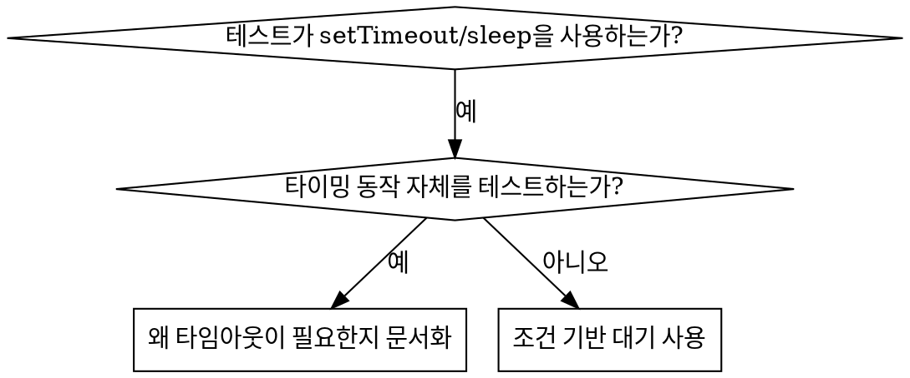

# 조건 기반 대기 (Condition-Based Waiting)

## 개요

불안정한 테스트(flaky tests)는 흔히 임의의 지연 시간(delay)을 두어 타이밍을 추측합니다. 이는 빠른 머신에서는 테스트가 통과하지만 부하가 걸리거나 CI 환경에서는 실패하는 경쟁 상태(race condition)를 만들어냅니다.

**핵심 원칙:** 얼마나 걸릴지 추측하지 말고, 당신이 실제로 관심 있는 조건이 충족될 때까지 기다리세요.

## 언제 사용하는가



**다음과 같은 경우에 사용하세요:**
- 테스트에 임의의 지연(`setTimeout`, `sleep`, `time.sleep()`)이 있을 때
- 테스트가 불안정할 때 (가끔 통과하고, 부하 상태에서 실패할 때)
- 병렬로 실행할 때 테스트가 타임아웃될 때
- 비동기 작업이 완료되기를 기다릴 때

**다음과 같은 경우에는 사용하지 마세요:**
- 디바운스(debounce)나 쓰로틀(throttle) 간격 같은 실제 타이밍 동작 자체를 테스트할 때
- 만약 임의의 타임아웃을 사용한다면 **왜(WHY)** 필요한지 항상 문서화하세요

## 핵심 패턴

```typescript
// ❌ BEFORE: 타이밍 추측하기
await new Promise(r => setTimeout(r, 50));
const result = getResult();
expect(result).toBeDefined();

// ✅ AFTER: 조건이 충족될 때까지 대기하기
await waitFor(() => getResult() !== undefined);
const result = getResult();
expect(result).toBeDefined();
```

## 빠른 패턴 참조 (Quick Patterns)

| 시나리오 | 패턴 |
|----------|---------|
| 이벤트 대기 | `waitFor(() => events.find(e => e.type === 'DONE'))` |
| 상태 대기 | `waitFor(() => machine.state === 'ready')` |
| 개수 대기 | `waitFor(() => items.length >= 5)` |
| 파일 대기 | `waitFor(() => fs.existsSync(path))` |
| 복합 조건 | `waitFor(() => obj.ready && obj.value > 10)` |

## 구현

범용 폴링(polling) 함수:
```typescript
async function waitFor<T>(
  condition: () => T | undefined | null | false,
  description: string,
  timeoutMs = 5000
): Promise<T> {
  const startTime = Date.now();

  while (true) {
    const result = condition();
    if (result) return result;

    if (Date.now() - startTime > timeoutMs) {
      throw new Error(`Timeout waiting for ${description} after ${timeoutMs}ms`);
    }

    await new Promise(r => setTimeout(r, 10)); // 10ms마다 폴링
  }
}
```

실제 디버깅 세션에서 작성된 도메인 특화 헬퍼(`waitForEvent`, `waitForEventCount`, `waitForEventMatch`)를 포함한 전체 구현은 이 디렉터리의 `condition-based-waiting-example.ts`를 참조하세요.

## 흔한 실수

**❌ 너무 빠른 폴링:** `setTimeout(check, 1)` - CPU를 낭비합니다
**✅ 해결:** 10ms마다 폴링하세요

**❌ 타임아웃 없음:** 조건이 영원히 충족되지 않으면 무한 루프에 빠집니다
**✅ 해결:** 명확한 에러 메시지와 함께 항상 타임아웃을 포함하세요

**❌ 오래된 데이터(Stale data):** 루프 진입 전에 상태를 캐싱함
**✅ 해결:** 최신 데이터를 얻기 위해 루프 내부에서 게터(getter)를 호출하세요

## 임의의 타임아웃이 올바른 경우

```typescript
// 도구가 100ms마다 틱(tick)을 발생시킴 - 부분 출력을 검증하려면 2번의 틱이 필요함
await waitForEvent(manager, 'TOOL_STARTED'); // 첫째: 트리거 조건이 될 때까지 대기
await new Promise(r => setTimeout(r, 200));   // 둘째: 시간에 따른 동작을 위해 대기
// 200ms = 100ms 간격으로 2번의 틱 - 문서화되고 정당화됨
```

**요구사항:**
1. 먼저 트리거 조건이 충족될 때까지 대기할 것
2. 추측이 아니라 알려진 타이밍 주기에 기반할 것
3. **왜(WHY)** 필요한지 설명하는 주석을 달 것

## 실제 적용 효과 (Real-World Impact)

디버깅 세션(2025-10-03) 결과:
- 3개 파일에 걸쳐 15개의 불안정한 테스트(flaky tests) 수정
- 통과율: 60% → 100%
- 실행 시간: 40% 단축
- 경쟁 상태(race conditions) 완전 제거
