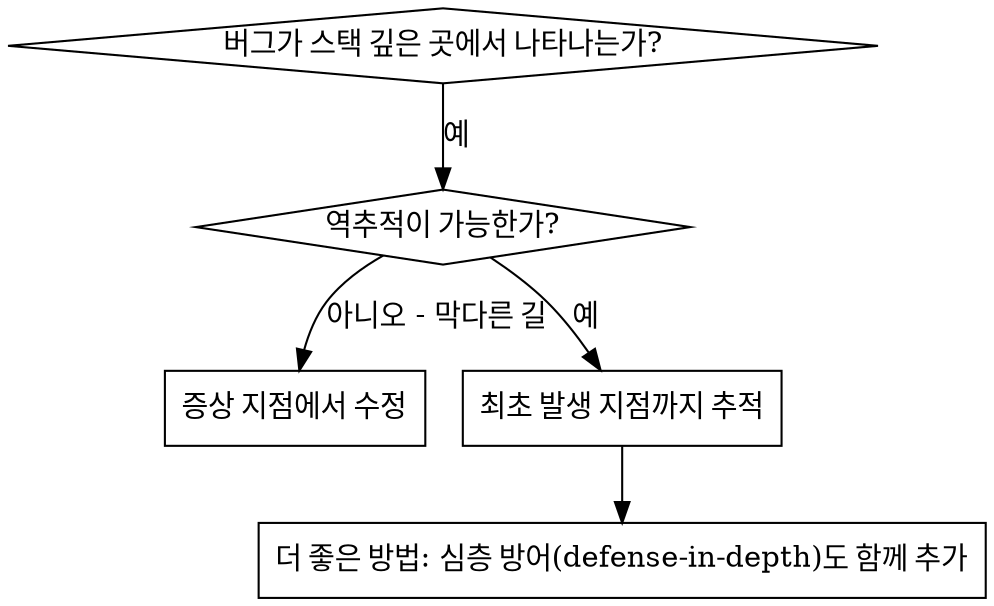
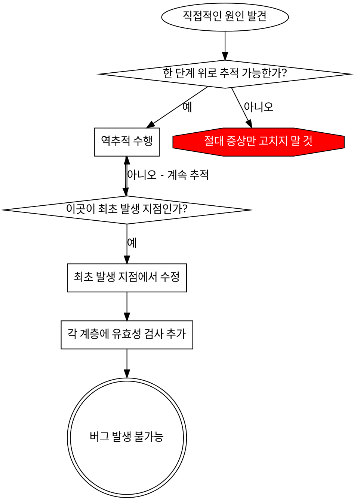

# 근본 원인 추적 (Root Cause Tracing)

## 개요

버그는 종종 콜 스택 깊은 곳에서 증상을 드러냅니다(잘못된 디렉터리에서의 `git init`, 잘못된 위치에 생성된 파일, 잘못된 경로로 열린 데이터베이스 등). 본능적으로는 에러가 나타난 지점을 고치고 싶겠지만, 그것은 증상만 치료하는 것입니다.

**핵심 원칙:** 최초 발생 지점(original trigger)을 찾을 때까지 호출 체인을 거꾸로 추적한 다음, 그 근원지(source)에서 수정하세요.

## 언제 사용하는가



**다음과 같은 경우에 사용하세요:**
- 에러가 진입점이 아닌 실행 깊은 곳에서 발생할 때
- 스택 트레이스에 긴 호출 체인이 표시될 때
- 잘못된 데이터가 어디서 시작되었는지 불분명할 때
- 어떤 테스트나 코드가 문제를 유발하는지 찾아야 할 때

## 추적 프로세스

### 1. 증상 관찰하기
```
Error: git init failed in ~/project/packages/core
```

### 2. 직접적인 원인 찾기
**어떤 코드가 이 에러를 직접 발생시키는가?**
```typescript
await execFileAsync('git', ['init'], { cwd: projectDir });
```

### 3. 질문하기: 무엇이 이 코드를 호출했는가?
```typescript
WorktreeManager.createSessionWorktree(projectDir, sessionId)
  → Session.initializeWorkspace()에 의해 호출됨
  → Session.create()에 의해 호출됨
  → Project.create()의 테스트에 의해 호출됨
```

### 4. 계속 위로 추적하기
**어떤 값이 전달되었는가?**
- `projectDir = ''` (빈 문자열!)
- `cwd`로 전달된 빈 문자열은 `process.cwd()`로 해석됨
- 그곳이 바로 소스 코드 디렉터리였음!

### 5. 최초 발생 지점(Original Trigger) 찾기
**빈 문자열은 어디서 왔는가?**
```typescript
const context = setupCoreTest(); // { tempDir: '' }를 반환함
Project.create('name', context.tempDir); // beforeEach가 실행되기 전에 접근함!
```

## 스택 트레이스 추가하기

수동으로 추적할 수 없을 때는 계측(instrumentation) 코드를 추가하세요:

```typescript
// 문제가 되는 작업 직전
async function gitInit(directory: string) {
  const stack = new Error().stack;
  console.error('DEBUG git init:', {
    directory,
    cwd: process.cwd(),
    nodeEnv: process.env.NODE_ENV,
    stack,
  });

  await execFileAsync('git', ['init'], { cwd: directory });
}
```

**중요:** 테스트에서는 로거(logger) 대신 `console.error()`를 사용하세요 (로거는 출력이 억제되어 보이지 않을 수 있습니다)

**실행 및 캡처:**
```bash
npm test 2>&1 | grep 'DEBUG git init'
```

**스택 트레이스 분석:**
- 테스트 파일 이름을 찾으세요
- 해당 호출을 유발한 줄 번호를 찾으세요
- 패턴을 식별하세요 (같은 테스트인가? 같은 파라미터인가?)

## 어떤 테스트가 오염(Pollution)을 일으키는지 찾기

테스트 실행 중에 무언가 이상한 상태가 나타나지만 어느 테스트 때문인지 모를 때:

이 디렉터리에 있는 이진 탐색 스크립트 `find-polluter.sh`를 사용하세요:

```bash
bash ./find-polluter.sh '.git' 'src/**/*.test.ts'
```

테스트를 하나씩 실행하며 첫 번째 오염 유발자(polluter)에서 멈춥니다. 사용법은 스크립트 내용을 참조하세요.

## 실제 예시: 비어 있는 projectDir

**증상:** `packages/core/`(소스 코드) 안에 `.git`이 생성됨

**추적 체인:**
1. `git init`이 `process.cwd()`에서 실행됨 ← 비어 있는 `cwd` 파라미터
2. `WorktreeManager`가 비어 있는 `projectDir`로 호출됨
3. `Session.create()`가 빈 문자열을 전달함
4. 테스트가 `beforeEach` 실행 전에 `context.tempDir`에 접근함
5. `setupCoreTest()`가 초기값으로 `{ tempDir: '' }`를 반환함

**근본 원인:** 최상위(top-level) 변수 초기화가 빈 값에 접근함

**수정:** `beforeEach` 이전에 접근하면 에러를 던지도록 `tempDir`를 게터(getter)로 변경함

**심층 방어(defense-in-depth)도 함께 추가함:**
- 계층 1: `Project.create()`에서 디렉터리 유효성 검사
- 계층 2: `WorkspaceManager`에서 비어 있지 않은지 검사
- 계층 3: `NODE_ENV` 가드가 `tmpdir` 외부에서의 `git init` 거부
- 계층 4: `git init` 실행 전 스택 트레이스 로깅

## 핵심 원칙



**절대 에러가 나타난 지점만 고치지 마세요.** 최초 발생 지점(original trigger)을 찾을 때까지 역추적하세요.

## 스택 트레이스 팁

**테스트 내부:** 로거(logger) 대신 `console.error()`를 사용하세요 - 로거는 출력이 억제될 수 있습니다
**작업 실행 전:** 위험한 작업이 실패한 후가 아니라 실행하기 **직전에** 로깅하세요
**컨텍스트 포함:** 디렉터리, `cwd`, 환경 변수, 타임스탬프를 함께 기록하세요
**스택 캡처:** `new Error().stack`은 전체 호출 체인을 보여줍니다

## 실제 적용 효과 (Real-World Impact)

디버깅 세션(2025-10-03) 결과:
- 5단계 추적을 통해 근본 원인 발견
- 최초 발생 지점에서 수정 (게터 유효성 검사)
- 4개 계층의 방어 로직 추가
- 1,847개 테스트 통과, 오염(pollution) 0건
