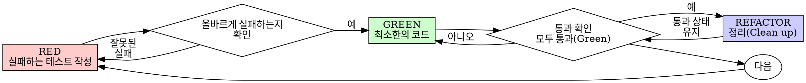

# 테스트 주도 개발 (Test-Driven Development, TDD)

## 개요

테스트를 먼저 작성하세요. 실패하는 것을 직접 확인하세요. 통과할 만큼의 최소한의 코드만 작성하세요.

**핵심 원칙:** 테스트가 실패하는 것을 직접 보지 않았다면, 그 테스트가 올바른 대상을 검증하고 있는지 알 수 없습니다.

**규칙의 문구를 어기는 것은 규칙의 정신을 어기는 것입니다.**

## 언제 사용하는가

**항상 사용:**
- 새로운 기능
- 버그 수정
- 리팩터링
- 동작 변경

**예외 (인간 파트너(human partner)에게 먼저 물어보세요):**
- 일회성 프로토타입
- 생성된(generated) 코드
- 설정 파일

"이번 한 번만 TDD를 건너뛸까?"라는 생각이 드나요? 멈추세요. 그것은 합리화입니다.

## 철칙(Iron Law)

```
NO PRODUCTION CODE WITHOUT A FAILING TEST FIRST
(실패하는 테스트 없이는 어떠한 프로덕션 코드도 작성하지 않는다)
```

테스트보다 코드를 먼저 작성했나요? 삭제하세요. 처음부터 다시 시작하세요.

**예외 없음:**
- "참고용"으로 남겨두지 마세요
- 테스트를 작성하면서 그 코드를 "조정(adapt)"하지 마세요
- 쳐다보지도 마세요
- 삭제란 말 그대로 완전히 지우는 것입니다

테스트로부터 완전히 새로 구현하세요. 끝.

## Red-Green-Refactor



### RED - 실패하는 테스트 작성

일어나야 할 동작을 보여주는 최소한의 테스트 하나를 작성하세요.

<Good>
```typescript
test('retries failed operations 3 times', async () => {
  let attempts = 0;
  const operation = () => {
    attempts++;
    if (attempts < 3) throw new Error('fail');
    return 'success';
  };

  const result = await retryOperation(operation);

  expect(result).toBe('success');
  expect(attempts).toBe(3);
});
```
명확한 이름, 실제 동작 테스트, 한 가지만 검증
</Good>

<Bad>
```typescript
test('retry works', async () => {
  const mock = jest.fn()
    .mockRejectedValueOnce(new Error())
    .mockRejectedValueOnce(new Error())
    .mockResolvedValueOnce('success');
  await retryOperation(mock);
  expect(mock).toHaveBeenCalledTimes(3);
});
```
모호한 이름, 코드가 아니라 모의 객체(mock)를 테스트함
</Bad>

**요구사항:**
- 하나의 동작만 다룰 것
- 명확한 이름일 것
- 실제 코드를 사용할 것 (불가피한 경우가 아니면 모의 객체(mock) 사용 금지)

### Verify RED - 실패하는 것을 직접 확인

**필수 사항입니다. 절대 건너뛰지 마세요.**

```bash
npm test path/to/test.test.ts
```

다음 사항을 확인하세요:
- 테스트가 (에러가 아니라) 실패함
- 실패 메시지가 예상한 것과 일치함
- 오타 때문이 아니라 기능이 아직 없어서 실패함

**테스트가 통과하나요?** 이미 존재하는 동작을 테스트하고 있는 것입니다. 테스트를 고치세요.

**테스트에서 에러가 나나요?** 에러를 수정하고 올바르게 실패할 때까지 다시 실행하세요.

### GREEN - 최소한의 코드

테스트를 통과시킬 가장 단순한 코드를 작성하세요.

<Good>
```typescript
async function retryOperation<T>(fn: () => Promise<T>): Promise<T> {
  for (let i = 0; i < 3; i++) {
    try {
      return await fn();
    } catch (e) {
      if (i === 2) throw e;
    }
  }
  throw new Error('unreachable');
}
```
통과하기에 딱 필요한 만큼만 작성
</Good>

<Bad>
```typescript
async function retryOperation<T>(
  fn: () => Promise<T>,
  options?: {
    maxRetries?: number;
    backoff?: 'linear' | 'exponential';
    onRetry?: (attempt: number) => void;
  }
): Promise<T> {
  // YAGNI
}
```
과도한 엔지니어링 (Over-engineered)
</Bad>

테스트 범위를 넘어선 기능 추가, 다른 코드 리팩터링, 또는 "개선"을 하지 마세요.

### Verify GREEN - 통과하는 것을 직접 확인

**필수 사항입니다.**

```bash
npm test path/to/test.test.ts
```

다음 사항을 확인하세요:
- 테스트가 통과함
- 다른 테스트들도 계속 통과함
- 출력이 깨끗함 (에러나 경고 없음)

**테스트가 실패하나요?** 테스트가 아니라 코드를 고치세요.

**다른 테스트가 실패하나요?** 지금 당장 고치세요.

**"다른 테스트"란 작성한 파일 하나가 아니라 프로젝트의 전체 테스트 스위트를 의미합니다.** 직접 작성한 테스트만 통과(green)했다고 해서 전체 스위트가 통과한 것은 아닙니다. 작업이 끝났다고 선언하기 전에, 설령 작업 지시서에 테스트 파일 하나만 명시되어 있었더라도 프로젝트의 전체 테스트 명령어(단독 `pytest`, `npm test`, `cargo test` 등 저장소에서 사용하는 명령)를 실행하세요. 작업 지시서의 범위 지정은 결과물의 범위를 제한하는 것이지 검증의 범위를 제한하는 것이 아닙니다. 해당 실행에서 나타난 모든 실패는 — 본인이 유발하지 않은 실패를 포함하여 — 보고서에 구체적인 이름으로 기재해야 합니다. 스크롤되어 지나가는 실패한(red) 테스트를 보고도 언급하지 않는 것은 누락에 의한 허위 보고입니다.

### REFACTOR - 정리(Clean Up)

오직 통과(green)한 후에만 수행하세요:
- 중복 제거
- 이름 개선
- 헬퍼 함수 추출

테스트 통과(green) 상태를 유지하세요. 새로운 동작을 추가하지 마세요.

### 반복 (Repeat)

다음 기능을 위해 다음 실패하는 테스트를 작성합니다.

## 좋은 테스트

| 품질 | 좋은 예 | 나쁜 예 |
|---------|------|-----|
| **최소성(Minimal)** | 한 가지만 검증. 이름에 "and"가 있나요? 나누세요. | `test('validates email and domain and whitespace')` |
| **명확성(Clear)** | 이름이 동작을 설명함 | `test('test1')` |
| **의도 표현(Shows intent)** | 바람직한 API 사용법을 보여줌 | 코드가 무엇을 해야 하는지 흐림 |

테스트를 작성하거나 변경할 때는 테스트의 정직성을 지키는 규칙을 담은 [writing-good-tests.md](writing-good-tests.md)를 읽으세요:
- 테스트를 작성하기 전에, 이 테스트를 실패하게 만들 프로덕션 변경 사항이 무엇인지 이름을 붙이세요
- 모의 객체(mock)의 동작이 아니라 실제 동작을 단언(assert)하세요
- 테스트 전용 코드는 프로덕션 클래스가 아닌 테스트 유틸리티에 두세요
- 의존성을 모킹(mocking)하기 전에 그 의존성의 부수 효과(side effects)를 먼저 이해하세요

## 흔한 합리화 (Common Rationalizations)

| 변명 | 현실 |
|--------|---------|
| "테스트하기엔 너무 단순하다" | 단순한 코드도 깨집니다. 테스트 작성에는 30초면 충분합니다. |
| "나중에 테스트하겠다" | 나중에 작성한 테스트는 즉시 통과하므로 아무것도 증명하지 못합니다. 잘못된 대상을 테스트하거나, 동작이 아닌 구현을 테스트하거나, 잊어버린 엣지 케이스를 놓칠 수 있습니다. 실패하는 것을 본 적이 없으니 버그를 잡아낼 수 있는지도 증명하지 못했습니다. 선(先) 테스트는 그 실패를 강제합니다. |
| "나중에 테스트해도 같은 목적을 달성한다 (의식이 아니라 정신이 중요하다)" | 사후 테스트는 "이 코드가 무엇을 하는가?"에 답하고, 사전 테스트는 "이 코드가 무엇을 해야 하는가?"에 답합니다. 사후에 작성된 테스트는 이미 작성한 코드에 편향되어, 미처 발견해야 했을 케이스가 아니라 기억해 낸 케이스만 검증합니다. 테스트가 작동한다는 증명 없는 커버리지일 뿐입니다. |
| "이미 수동으로 테스트했다" | 수동 테스트는 임시방편입니다. 무엇을 검증했는지 기록이 남지 않고, 코드가 바뀔 때 똑같이 재실행할 수 없으며, 압박 속에서 케이스를 잊어버리기 쉽습니다. "내가 해봤을 땐 됐는데" ≠ 포괄적인 검증. 자동화된 테스트는 매번 동일한 방식으로 실행됩니다. |
| "X시간 동안 작성한 코드를 지우는 건 낭비다" | 매몰 비용 오류(Sunk cost fallacy)입니다. 그 시간은 어차피 이미 지나갔습니다. 진짜 선택지는 TDD로 다시 작성하기(높은 신뢰도) vs 기존 코드를 두고 사후에 테스트 덧붙이기(낮은 신뢰도, 버그 가능성 높음)입니다. 신뢰할 수 없는 코드를 남겨두는 것이야말로 낭비입니다. |
| "참고용으로 남겨두고 테스트부터 작성하겠다" | 결국 그 코드를 가져다 수정하게 됩니다. 그것은 사후 테스트입니다. 삭제란 말 그대로 완전히 지우는 것입니다. |
| "먼저 탐색(explore)해 볼 필요가 있다" | 좋습니다. 탐색용 코드는 버리고 TDD로 시작하세요. |
| "테스트하기 어렵다 = 설계가 불분명하다" | 테스트가 주는 신호에 귀를 기울이세요. 테스트하기 어렵다는 것은 사용하기 어렵다는 뜻입니다. |
| "TDD를 하면 속도가 느려질 것이다" | TDD야말로 실용적인 길입니다. 커밋 전에 버그를 잡고, 회귀(regression)를 방지하며, 두려움 없이 리팩터링할 수 있게 해줍니다. "실용적"이라며 택한 지름길은 결국 프로덕션 환경에서의 디버깅으로 이어져 더 빠르기는커녕 더 느려집니다. |
| "수동 테스트가 더 빠르다" | 수동 테스트는 엣지 케이스를 증명하지 못합니다. 변경할 때마다 다시 테스트해야 할 것입니다. |
| "기존 코드에 테스트가 없다" | 당신은 지금 코드를 개선하고 있습니다. 기존 코드에 대한 테스트를 추가하세요. |

## 위험 신호(Red Flags) - 멈추고 처음부터 다시 시작하세요

- 테스트보다 코드를 먼저 작성함
- 구현 후에 테스트를 작성함
- 테스트가 한 번에 바로 통과함
- 테스트가 왜 실패했는지 설명할 수 없음
- 테스트를 "나중에" 추가함
- "이번 한 번만"이라고 합리화함
- "이미 수동으로 테스트했다"
- "나중에 테스트해도 같은 목적을 달성한다"
- "형식적인 의식(ritual)이 아니라 정신(spirit)이 중요하다"
- "참고용으로 남겨두자" 또는 "기존 코드를 수정해서 쓰자"
- "이미 X시간을 썼는데 지우는 건 낭비다"
- "TDD는 교조적이다, 나는 실용적으로 하겠다"
- "이번 경우는 다른데 왜냐하면..."

**이 모든 것은 다음을 의미합니다: 코드를 삭제하세요. TDD로 처음부터 다시 시작하세요.**

## 예시: 버그 수정

**버그:** 빈 이메일이 허용됨

**RED**
```typescript
test('rejects empty email', async () => {
  const result = await submitForm({ email: '' });
  expect(result.error).toBe('Email required');
});
```

**Verify RED**
```bash
$ npm test
FAIL: expected 'Email required', got undefined
```

**GREEN**
```typescript
function submitForm(data: FormData) {
  if (!data.email?.trim()) {
    return { error: 'Email required' };
  }
  // ...
}
```

**Verify GREEN**
```bash
$ npm test
PASS
```

**REFACTOR**
필요한 경우 여러 필드에 대한 유효성 검증 로직을 추출합니다.

## 검증 체크리스트

작업을 완료로 표시하기 전에 확인하세요:

- [ ] 모든 새로운 함수/메서드에 테스트가 있는가
- [ ] 구현하기 전에 각 테스트가 실패하는 것을 직접 보았는가
- [ ] 각 테스트가 예상한 이유(오타가 아니라 기능 미구현)로 실패했는가
- [ ] 각 테스트를 통과시키기 위해 최소한의 코드만 작성했는가
- [ ] 모든 테스트가 통과하는가
- [ ] 실행 출력이 깨끗한가 (에러나 경고 없음)
- [ ] 테스트가 실제 코드를 사용하는가 (불가피한 경우에만 모의 객체 사용)
- [ ] 엣지 케이스와 에러 조건이 다루어졌는가

모든 항목에 체크할 수 없나요? TDD를 건너뛴 것입니다. 처음부터 다시 시작하세요.

## 막혔을 때 (When Stuck)

| 문제 | 해결책 |
|---------|----------|
| 어떻게 테스트해야 할지 모르겠다 | 원하는 형태의 API를 먼저 작성해 보세요. 단언문(assertion)부터 먼저 작성하세요. 인간 파트너(human partner)에게 물어보세요. |
| 테스트가 너무 복잡하다 | 설계가 너무 복잡한 것입니다. 인터페이스를 단순화하세요. |
| 모든 것을 모킹(mock)해야 한다 | 코드의 결합도가 너무 높은 것입니다. 의존성 주입(dependency injection)을 사용하세요. |
| 테스트 설정(setup)이 너무 거대하다 | 헬퍼를 추출하세요. 그래도 복잡하다면? 설계를 단순화하세요. |

## 디버깅과의 통합

버그를 발견했나요? 그 버그를 재현하는 실패하는 테스트를 작성하세요. TDD 사이클을 따르세요. 테스트가 수정을 증명하고 회귀(regression)를 방지합니다.

절대 테스트 없이 버그를 수정하지 마세요.

## 최종 규칙

```
프로덕션 코드 → 테스트가 존재하며 먼저 실패했어야 함
그렇지 않다면 → TDD가 아님
```

인간 파트너(human partner)의 허락 없이는 어떠한 예외도 없습니다.
