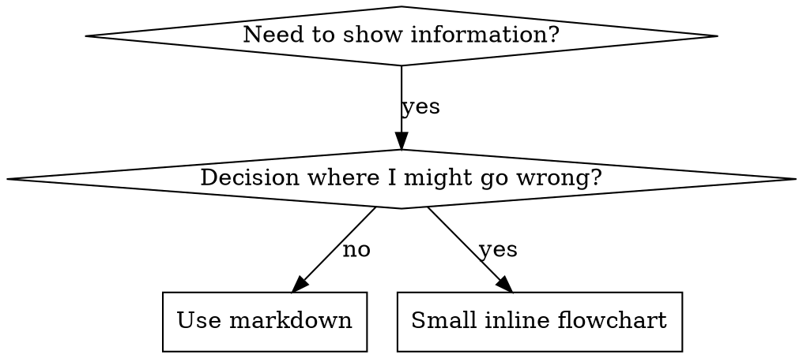

# 스킬 내 플로우차트 작성법 (Flowcharts in Skills)

superpowers:writing-skills의 일부입니다.

## 플로우차트 사용 기준 (Flowchart Usage)



**오직 다음의 경우에만 플로우차트를 사용하세요:**
- 자명하지 않은 의사결정 분기점
- 너무 일찍 멈추기 쉬운 프로세스 루프
- "언제 A를 쓰고 언제 B를 쓸 것인가"에 대한 결정

**다음의 경우에는 절대로 플로우차트를 사용하지 마세요:**
- 레퍼런스 자료 → 테이블이나 리스트 사용
- 코드 예제 → 마크다운 코드 블록 사용
- 선형적인 지침 → 번호 매기기 리스트(Numbered lists) 사용
- 의미론적 뜻이 없는 라벨 (`step1`, `helper2`)

graphviz 스타일 규칙은 이 디렉터리의 `graphviz-conventions.dot`을 참조하세요.

**인간 파트너(human partner)를 위한 시각화:** 스킬의 플로우차트를 SVG로 렌더링하려면 `writing-skills` 디렉터리에 있는 `render-graphs.js`를 해당 디렉터리에서 실행하세요:
```bash
node ./render-graphs.js ../some-skill           # 각 다이어그램을 개별 파일로 렌더링
node ./render-graphs.js ../some-skill --combine # 모든 다이어그램을 하나의 SVG로 결합하여 렌더링
```
